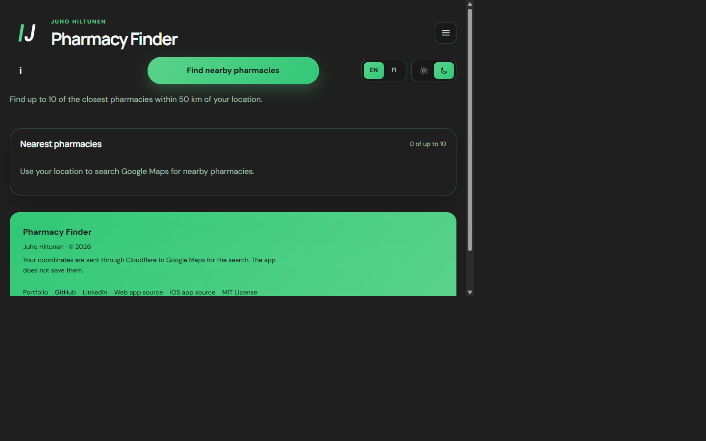
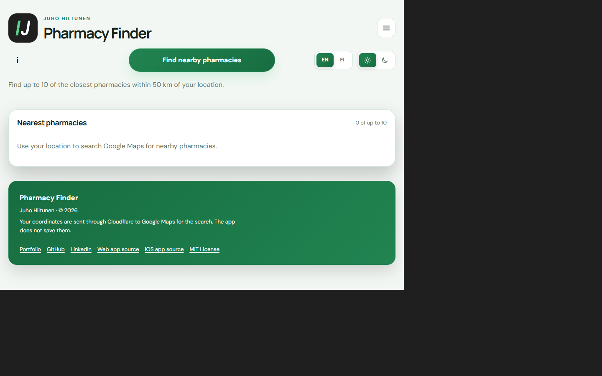
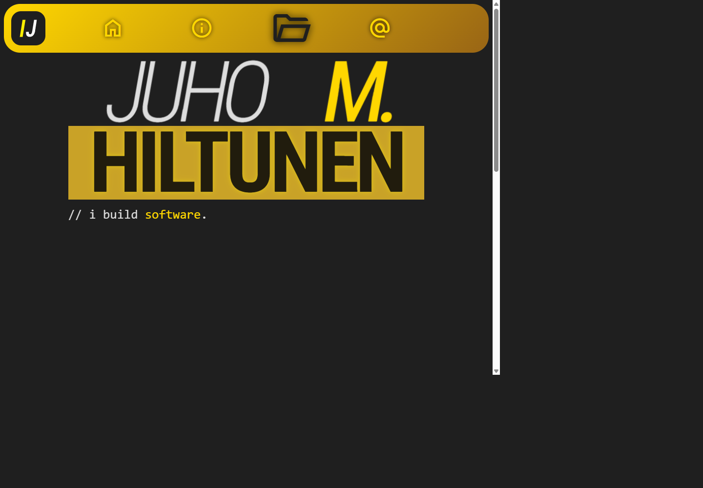
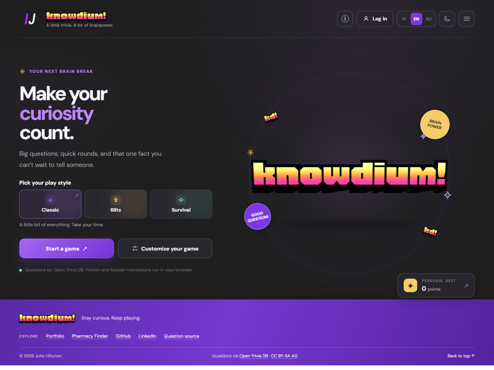

  

<h1 align="center">Juho M. Hiltunen</h1>

  Software developer · product-minded builder · problem solver 
  <a href="https://hiltunenjuho.github.io/"><strong>Visit the live portfolio</strong></a>

  
  
  
  

## About

This portfolio presents selected software projects, my approach to problem-solving, and ways to get in touch. It is built as a small React and TypeScript application, with reusable components for navigation, content panels, project cards, and carousels. The header includes a branded app switcher linking to this portfolio, Pharmacy Finder, and Knowdium.

## Selected work

- **[Pharmacy Finder](https://hiltunenjuho.github.io/nearest-pharmacy-web/):** a live web demo for finding nearby pharmacies, checking available opening information, and planning a route. The project also includes a SwiftUI package for an iOS host app: [web source](https://github.com/hiltunenjuho/nearest-pharmacy-web) · [iOS package](https://github.com/hiltunenjuho/nearest-pharmacy-ios).
- **[Portfolio](https://hiltunenjuho.github.io/):** an interactive site for selected work and background, with source in the [portfolio repository](https://github.com/hiltunenjuho/hiltunenjuho.github.io).
- **[Knowdium](https://hiltunenjuho.github.io/knowdium/):** a playable multilingual trivia game with three modes, live questions and optional in-browser translation. [Source code](https://github.com/hiltunenjuho/knowdium).

## Screenshots

  
  

<em>Pharmacy Finder's live web demo in dark and light themes.</em>

  
  

<em>Portfolio homepage and Knowdium's English-language home page.</em>

## Live website

The portfolio is published on GitHub Pages: **[hiltunenjuho.github.io](https://hiltunenjuho.github.io/)**.
Explore the live site for selected projects, background, and contact details; project cards link
directly to available demos and source repositories.

## Deployment

The GitHub Actions workflow builds the app and publishes the `dist` directory to GitHub Pages when changes are pushed to `main`. Set the repository's Pages source to **GitHub Actions** to enable the workflow.

## License

The website source code is licensed under the [MIT License](./LICENSE). Personal content and branding are not included.
